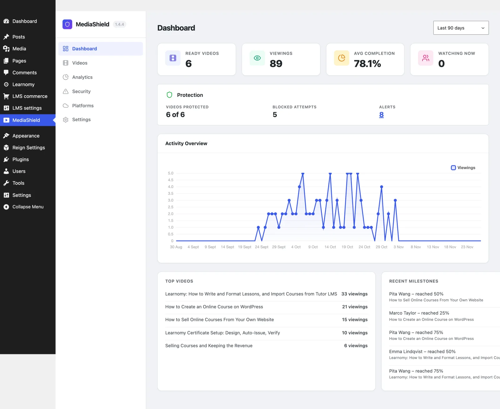

# Every Admin Screen

**Free + Pro.** Free gives you the seven screens in the first table. Pro adds more entries to the same sidebar; each is listed in the second table.

Everything lives under one **MediaShield** menu in the WordPress sidebar. It opens a single app with its own left-hand menu. The address changes after a `#`, so you can bookmark any screen, for example `wp-admin/admin.php?page=mediashield#/settings`.

## The menu: six groups

The app's left-hand menu has six items. Click one to open its first screen; the group's other screens are listed under it while you are in that group.

| Menu item | Screens in it |
|-----------|---------------|
| Dashboard | Dashboard |
| Videos | Videos, Playlists, Tags, Upload Queue (Pro) |
| Analytics | Viewers, Heatmap (Pro), Realtime (Pro), Milestones, Export (Pro) |
| Security | Alerts (Pro) |
| Platforms | Platforms and the library browsers (Pro) |
| Settings | Settings, License (Pro), Milestone Actions (Pro) |

Without Pro, the Pro screens show as locked entries with a PRO label. Every screen keeps its own address, so bookmarks and links from before 1.4.3 still open the same screen. On a phone the six items are a row of icons and the open group's screens are a second row.

## Before you start

- Only administrators can open these screens.
- Without JavaScript the app shows a message asking you to turn it on.

## Screens in Free

| Screen | Address ending | What you do there |
|--------|----------------|-------------------|
| Dashboard | `#/dashboard` | See Ready videos (published, with something that plays), sessions, average completion and live viewers; a Protection card (Ready videos protected, a link to the videos that need attention, and with Pro the blocked DevTools attempts and alerts in the period); an activity chart with every day of the period, drawn in straight lines so a day without viewings reads as none; Top Videos; and Recent Milestones, one line per viewer and video ("Aisha Khan - finished"). Pick Today, 7, 30 or 90 days. Until the first viewing, a four-step Get started checklist sits at the top: add your first video, protect it, place it on a page, and watch it as a member (its button opens the page that shows your video). Only the next step has a button. It goes away for good once anyone has played a video; MediaShield adds no sample data. Until then each Analytics screen (Viewers, Heatmap, Realtime, Milestones, Export) shows the same steps above its empty list, headed Nothing to show yet. |
| Videos | `#/videos` | Search and filter the library by platform and protection, and by status with the chips All, Ready, Needs attention and Draft (each with its count). A video's status is Ready, No source (with an Add a link or upload link), Unavailable at YouTube or Vimeo (the platform says it was removed or made private; Replace link), or Draft. When any video needs attention a line above the list says how many, with Show only these; `#/videos/attention` opens on that chip. Each row shows the source (the platform, or Uploaded file and its name), length, protection level, where it is used and the status, with Edit, Preview and Copy shortcode. On a phone each video is one compact card: title, status, and one line of source, length and level. Apply bulk actions or restore from Trash. See [Video Hosts](../using-mediashield/10-video-hosts.md). |
| Playlists | `#/playlists` | List playlists with how many videos each holds (an empty one says it shows nothing on the page yet) and badges for Autoplay, Loop and Shuffle. Create one, open **Manage items** to add, reorder and set playback options, view or edit it. |
| Viewers | `#/viewers` | Search by name or email. See videos watched, average completion and last active; a member watching now has a Watching now badge and a **Stop playback** button. Click a viewer for their watch history and milestone tags, at its own address `#/viewers/<id>`. The old address `#/students` still works. |
| Tags | `#/tags` | Video tags: create, rename and delete. Each row shows name, slug and how many videos carry it; the count opens the Videos list filtered to that tag (`#/videos/tag/<id>`). Member milestone tags are on each viewer's page, not here. |
| Milestones | `#/milestones` | A log of every milestone reached (the header counts them): viewer, video, percentage and time, newest first, 20 per page. |
| Settings | `#/settings` | All plugin options. See [Settings Overview](01-settings-overview.md). |

## Screens added by Pro

| Screen | Address ending | Purpose |
|--------|----------------|---------|
| Platforms | `#/platforms` | Connect Bunny, YouTube, Vimeo and Wistia accounts. |
| Bunny, YouTube, Vimeo, Wistia browsers | `#/bunny-browser` and so on | Browse a connected library and import videos. |
| Alerts | `#/alerts` | Review suspicious viewing flagged by detection. |
| Heatmap | `#/heatmap` | See where in a video viewers watch and drop off. |
| Realtime | `#/realtime` | See who is watching now. |
| Export | `#/export` | Download CSV or PDF reports. |
| Upload Queue | `#/upload-queue` | Follow uploads to connected platforms. |
| Milestone Actions | `#/milestone-config` | Run an action when a viewer reaches a milestone. |
| License | `#/license` | Enter and check your Pro licence key. |

## Other places MediaShield appears

| Where | What |
|-------|------|
| Video edit screen | See [The Video Edit Screen](06-video-edit-screen.md). |
| Playlist edit screen | The classic edit screen, like a video's: title, then Videos in this playlist (order and Playback options), then an optional description. |
| Setup wizard | `wp-admin/admin.php?page=mediashield-wizard`. See [Setup Wizard](../getting-started/03-setup-wizard.md). |
| Tools > Site Health | A check that tells you whether self-hosted video files can be downloaded directly. |
| Settings > Privacy | MediaShield adds itself to WordPress's personal data export and erase tools. See [Privacy, Retention and Uninstall](../using-mediashield/17-privacy-retention-and-uninstall.md). |
| Plugins page | A one-off "Unlock the full power of MediaShield" notice appears on the MediaShield screen a week after install, until dismissed. Without Pro only. |

## Next steps

- [Settings Overview](01-settings-overview.md)
- [Analytics and Milestones](../using-mediashield/02-analytics-and-milestones.md)
