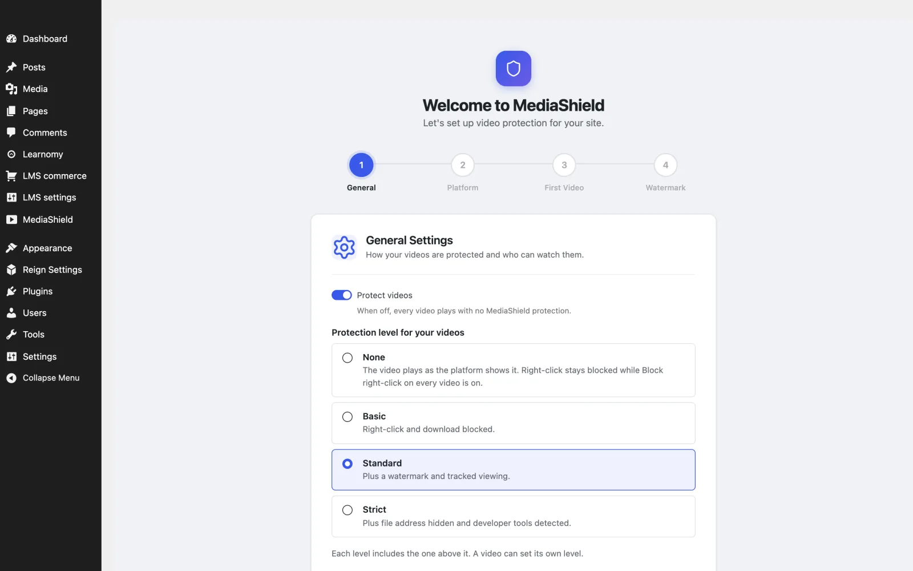

# Setup Wizard

On first activation, MediaShield redirects you to a four-step setup wizard. The wizard lets you configure the essentials before adding any videos.

Every control saves as soon as you change it, so nothing is lost if you close the tab. There is no link back to the wizard from the admin menu, though: if you leave part way through and want to return, open `wp-admin/admin.php?page=mediashield-wizard` directly. Everything the wizard sets is also available under **MediaShield > Settings**, so skipping it costs you nothing.

## Step 1 - General Settings

**Protect videos** - The master on/off switch for all MediaShield features. Leave this on. With it off, videos still play, but with no watermark, no protection layer, and no session tracking.

**Protection level for your videos** - The four levels, in the same words as Settings and the video edit screen; each includes the one above it. Standard is picked to start with. A video can set its own level. See [Protection Settings](../configuration/02-protection-settings.md).

**Who can watch?** - Two plain choices: **Anyone who opens the page** (visitors and members, good for trailers and public videos) or **Logged-in members only** (visitors see a login prompt instead of the video). Your site's current setting is preselected, so an existing site keeps its choice until you pick another. It applies at every protection level. Change it later under **Settings > Who can watch**; a video can also be limited to one role.

## Step 2 - Where are your videos?

Tick every place you host videos: YouTube, Vimeo, Wistia (paste a link, no account needed) and Upload to this site (files stay private and play through a signed link). With Pro, Bunny Stream is a choice too; in Free it is shown as a Pro tile with one link. The ticks only shape the next step (which links it asks for, and an Upload a file instead link); nothing is saved, and any supported link works later.

## Step 3 - Protect your first video (optional)

Paste a link and click **Check and add**, or paste it and press **Save & Continue**, which adds the link first. If the link is refused the step stays open with the reason, and the step is ticked only once the video exists. The link is checked before anything is saved. A link MediaShield cannot play is refused with "This link is not a video MediaShield can play" and what to use instead, and no video is created. A good link shows the video as it now is in your library: its title, platform, protection level and Ready, with the shortcode to paste.

Supported links:
- YouTube: `https://www.youtube.com/watch?v=...`, `https://youtu.be/...`, Shorts
- Vimeo: `https://vimeo.com/...`
- Wistia: your Wistia media or embed URL
- Bunny Stream (Pro): the video's embed URL, or its URL from the Bunny video page
- A video file: any direct `.mp4`, `.webm`, `.mov`, `.m4v` or `.m3u8` URL

If you skip this step, you can add videos any time from **MediaShield > Videos**.

## Step 4 - Watermark Settings

Configure the identity overlay drawn on top of the video while it plays:

**Opacity** - A slider from 0.1 to 1.0, where 1.0 is fully solid. Values around 0.3 to 0.5 are visible enough to deter sharing without being distracting.

**Text Color** - The watermark text color. Use a color that contrasts with your typical video content.

**Position swap interval** - How many seconds the watermark stays in one position before moving to the next. Shorter intervals make it harder to crop out of a recording.

The free watermark shows the viewer's display name and email. Their IP address is shown only if you turn on **Show the viewer's IP address** under Settings > Watermark. Pro adds 7 configurable fields including email, user ID, timestamp, site name, and custom text.

## After the wizard

Click **Finish** to mark setup complete and land on the dashboard. From here you can:

- Add and manage videos from **MediaShield > Videos**
- Fine-tune all settings from **MediaShield > Settings**
- Watch analytics appear in **MediaShield > Dashboard** as viewers watch your content

Next: [Add Your First Video](04-add-your-first-video.md)
