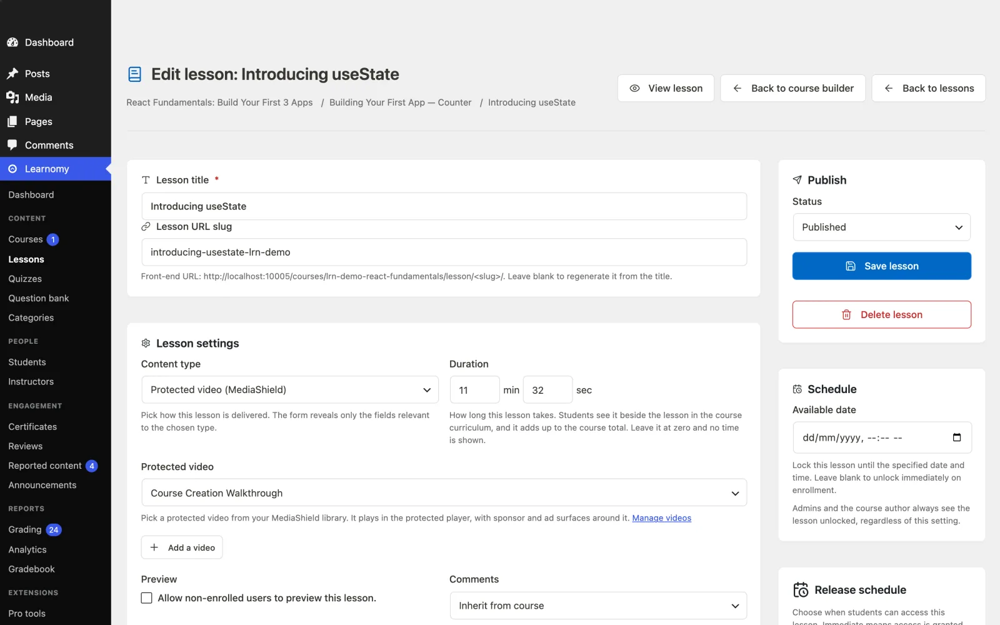

# Courses with Learnomy

**Included in Free.** Needs the Learnomy plugin. Learnomy is not included in MediaShield.

Learnomy can place a MediaShield video inside a lesson, so the lesson plays in the protected player.

## Why use it

Lessons in Learnomy play in the protected player, so the same rules, watermark and watch data apply to course content without extra setup per lesson.

## Before you start

- Learnomy and MediaShield are both active.
- The video exists in MediaShield and is published. See [Add Your First Video](../getting-started/04-add-your-first-video.md).

## Steps

1. In Learnomy, edit the lesson.
2. Set **Content type** to **Protected video (MediaShield)**. This choice appears only while MediaShield is active.
3. In **Protected video**, pick the video from the list.
4. Save the lesson.

Learnomy stores the video's ID in the lesson and shows it with the MediaShield player. The student sees the watermark, the login and role checks, and the player settings you chose.

## What to know

- The Learnomy lesson editor lists a limited number of videos in a dropdown. If your library is very large and the video is missing, check that it is published.
- **Learnomy 2.4.1 or later:** set "watch the video to complete" on each lesson, the same way as any video lesson: in the lesson's **Completion**, choose **Auto: video watched** and the minimum %. MediaShield measures how much the student watched and Learnomy completes the lesson when the share is reached. "Watched" is time spent watching, added up across sittings: dragging the scrubber ahead does not count, and a part watched twice counts once. A new protected video lesson starts at the % set under **MediaShield > Settings > Lesson Completion**, and when that % is above 0, on the first update Learnomy copies it onto your existing Manual protected video lessons, so nothing changes for students. With only Learnomy active, that setting is replaced by a sentence pointing to the lesson.
- **Learnomy 2.4.0 or earlier:** Learnomy's own "minimum video watch percentage" rule does not apply to MediaShield lessons. Use MediaShield's instead: under **MediaShield > Settings > Lesson Completion**, set **Require this % of the video watched before Complete** (0 turns it off, the default). With 80, the lesson's Complete button stays disabled under a "Watch 80% to complete" bar until the student has watched 80% of the lesson video, then turns on by itself. A completion sent any other way before that is refused. Site administrators and the course's instructor are not held back, Learnomy's "advisory" enforcement shows the bar without blocking, and a lesson already completed stays completed.
- A member who is not enrolled sees "This video is part of <course>. Enroll to watch it." with a **View course** button that opens the course page, instead of a bare refusal. Change both under **Settings > Login & Access Messages**. The player's controls are hidden while the message shows.
- The same setting gates LearnDash lessons that a video is linked to in MediaShield Pro: Mark Complete reads "Watch 80% to complete" and is disabled until then.
- Free-preview lessons: with **Require Login** on, guests normally see the login prompt on every MediaShield video. From Learnomy 2.2.0 with MediaShield 1.4.1, Learnomy tells MediaShield which videos sit in a free-preview lesson, so guests can watch those and still need an account for the rest. See [Access Control](../configuration/04-access-control.md).
- In the My Videos block, a Learnomy member's video titles link to the lesson that holds the video. See [Viewers, Tags and My Videos](14-viewers-tags-and-my-videos.md).
- MediaShield still records the session, completion percentage and milestones. See them under **MediaShield > Viewers** and **Milestones**.
- If the video cannot play, the lesson shows a message that it uses a protected video that cannot be played right now. Check the video is published.
- The LMS adapters in MediaShield Pro cover LearnDash, Tutor LMS and LifterLMS. Learnomy is not one of them.
- For the mobile or app side, Learnomy's lesson data includes a signed MediaShield embed address that lasts 15 minutes. This is for developers; see [Developer Overview](../developer-guide/01-overview.md).

## Check it worked

Open the lesson as an enrolled student. The protected player appears with your watermark.

## Next steps

- [Integrations](18-integrations.md)
- [Restrict Who Can Watch](08-restrict-who-can-watch.md)
- [Analytics and Milestones](02-analytics-and-milestones.md)
